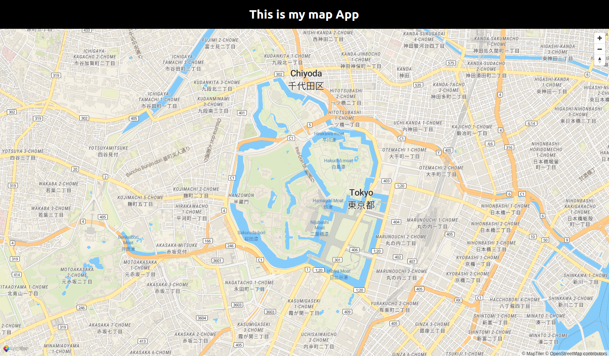

# MapLibre GL JS map using React JS

Quick way to star a web map application with MapLibre GL JS using Create React App.

A simple fullscreen map application as an example on how to use MapTiler maps together with React and MapLibre GL JS for your own React app.

The map application contains a title component, a map component with navigation controls, and a marker.

[](https://www.npmjs.com/package/maplibre-gl)


---

📖 [Documentation](https://docs.maptiler.com/react/) &nbsp; 🌐 [Website](https://www.maptiler.com/) &nbsp; 🔑 [Get API Key](https://cloud.maptiler.com/account/keys/)

---

<br>

<details> <summary><b>Table of Contents</b></summary>
<ul>
<li><a href="#-basic-usage">Basic Usage</a></li>
<li><a href="#-related-examples">Examples</a></li>
<li><a href="#-support">Support</a></li>
<li><a href="#-contributing">Contributing</a></li>
<li><a href="#-license">License</a></li>
<li><a href="#-acknowledgements">Acknowledgements</a></li>
</ul>
</details>

<p align="center">   
<br>

## 🚀 Basic Usage

### Create an app

To create a new react project run in your command-line:

```shell
npx create-react-app my-react-map --template @maptiler/cra-template-maplibre-gl-js
```

Navigate to the newly created project folder **my-react-map**

```shell
cd my-react-map
```

### API KEY

Rename or copy the `.env.example` file to `.env`

```shell
cp .env.example .env
```

Open the `.env` file, :warning: you will need to replace **YOUR_MAPTILER_API_KEY** with your own MapTiler API key.

Your MapTiler account access key is on your MapTiler [Cloud](https://cloud.maptiler.com/account/keys/) account page.

:information_source: If you don't have an API KEY you can create it for free at https://www.maptiler.com/cloud/

### Run

To start your local environment run:

```shell
npm start
```

You will find your app on address http://localhost:3000/.

Now you should see the app in your browser.

### Build

To build for production, run:

```shell
npm run build
```

### gh-pages

To deploy the app to the gh-pages branch, run:

```
npm run deploy
```

<br>

## 💡 Related Examples

- [How to display MapLibre GL JS map using React JS](https://docs.maptiler.com/react/maplibre-gl-js/how-to-use-maplibre-gl-js/)
- [Get Started with React JS and MapLibre GL JS](https://docs.maptiler.com/react/maplibre-gl-js/get-started/)
- [MapLibre GL JS geocoding control how to search places using React JS](https://docs.maptiler.com/react/maplibre-gl-js/geocoding-control/)

Check out the full list of [MapTiler examples](https://docs.maptiler.com/react/examples/)

<br>

## 💬 Support

- 📚 [Documentation](https://docs.maptiler.com/react/) - Comprehensive guides and API reference
- ✉️ [Contact us](https://maptiler.com/contact) - Get in touch or submit a request
- 🐦 [Twitter/X](https://twitter.com/maptiler) - Follow us for updates

<br>

---

<br>

## 🤝 Contributing

We love contributions from the community! Whether it's bug reports, feature requests, or pull requests, all contributions are welcome:

- Fork the repository and create your branch from `main`
- If you've added code, add tests that cover your changes
- Ensure your code follows our style guidelines
- Give your pull request a clear, descriptive summary
- Open a Pull Request with a comprehensive description

<br>

## 📄 License

This project is licensed under the MIT License – see the [LICENSE](./LICENSE) file for details.

<br>

## 🙏 Acknowledgements

This project is built on the shoulders of giants:

- [MapTiler](https://www.maptiler.com/) – Maps for developers
- [MapLibre GL JS](https://maplibre.org/maplibre-gl-js/docs/) – Open-source TypeScript library for publishing maps on your website
- [React.js](https://react.dev/) – The library for web and native user interfaces

<br>

<p align="center" style="margin-top:20px;margin-bottom:20px;"> <a href="https://cloud.maptiler.com/account/keys/" style="display:inline-block;padding:12px 32px;background:#F2F6FF;color:#000;font-weight:bold;border-radius:6px;text-decoration:none;"> Get Your API Key <sup style="background-color:#0000ff;color:#fff;padding:2px 6px;font-size:12px;border-radius:3px;">FREE</sup><br /> <span style="font-size:90%;font-weight:400;">Start building with 100,000 free map loads per month ・ No credit card required.</span> </a> </p>

<br>

<p align="center"> 💜 Made with love by the <a href="https://www.maptiler.com/">MapTiler</a> team <br />
<p align="center">
  <a href="https://www.maptiler.com/">Website</a> •
  <a href="https://docs.maptiler.com/react/">Documentation</a> •
  <a href="https://github.com/maptiler/cra-template-maplibre-gl-js">GitHub</a>
</p>
